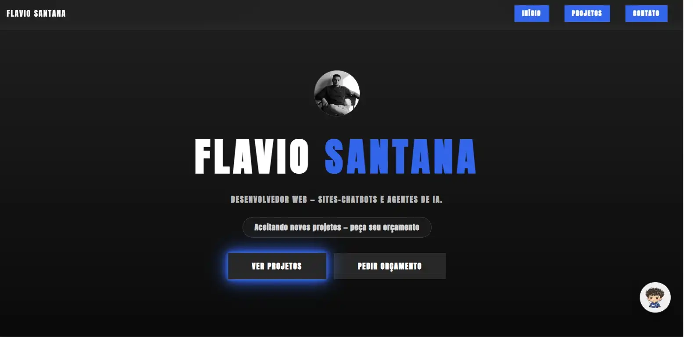

# Portfólio — Flavio Santana | Criação de Sites, Chatbots e Agentes de IA

Site de portfólio profissional desenvolvido para apresentar serviços de criação de sites, landing pages, chatbots e agentes de IA, reunir projetos publicados e facilitar o contato para orçamentos.



## Demonstração

- **Site online:** [https://portifolio-para-clientes.vercel.app/](https://portifolio-para-clientes.vercel.app/)

## Prévia do projeto


## Tecnologias e bibliotecas utilizadas

- **HTML5** (`index.html` e `projetos.html` com estrutura semântica, SEO, Open Graph e Twitter Card)
- **CSS3** (estilos modulares em `CSS/` e responsividade)
- **JavaScript (ES6+)** e **jQuery (`3.7.1`)** (`script.js` para destaque de navegação por rolagem e controle da janela do chatbot)
- **ScrollReveal** (animações de entrada para seções, títulos, descrições e cards)
- **Vanilla-tilt (`1.8.1`)** (`vanilla-tilt.js` para efeito de inclinação 3D nos cards de projetos)
- **Formspree** (envio de mensagens pelo formulário de contato)
- **Google Fonts** (`Anton`)

## Seções e funcionalidades

- **Navbar (`<header>`):** navegação por âncoras para `Início`, `Projetos` e `Contato`.
- **Hero (`#inicio`):** apresentação profissional, disponibilidade para novos projetos e botões de ação direta (`VER PROJETOS` e `PEDIR ORÇAMENTO`).
- **Projetos (`#projetos` e `projetos.html`):** grade de cards com imagem, descrição e link para projetos publicados (como God of War Ragnarök, GTA IV, Homem-Aranha: Um Novo Dia, Marvel's Spider-Man 2, Academia Fitness e SomaRápida), além de link para a segunda página (`projetos.html`).
- **Contato (`#contato`):** links para LinkedIn, GitHub, WhatsApp e Instagram, acompanhados de formulário integrado ao Formspree.
- **Assistente Virtual (Chatbot):** botão flutuante com janela expansível, minimizar e fechar, carregando o assistente via `iframe`.

## Estrutura de pastas

```text
├── index.html
├── projetos.html
├── script.js
├── vanilla-tilt.js
├── imagem/
└── CSS/
    ├── chatbot.css
    ├── footer.css
    ├── geral.css
    ├── hero.css
    ├── header.css
    ├── responsivo.css
    └── section.css